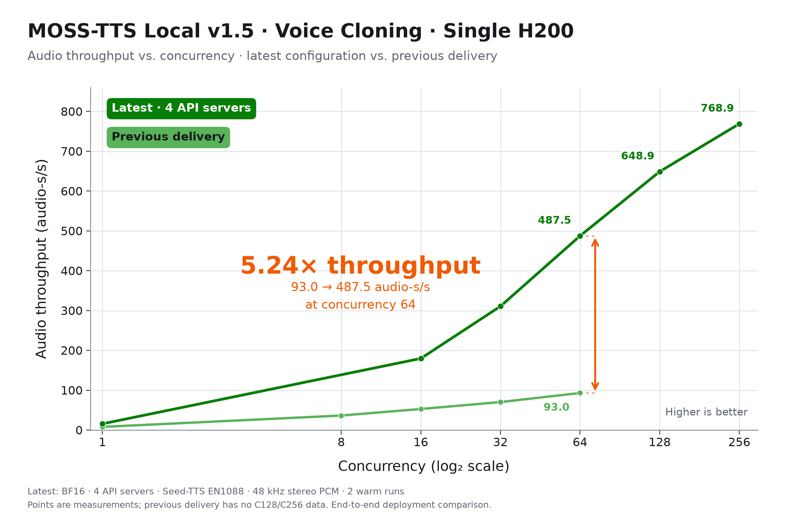
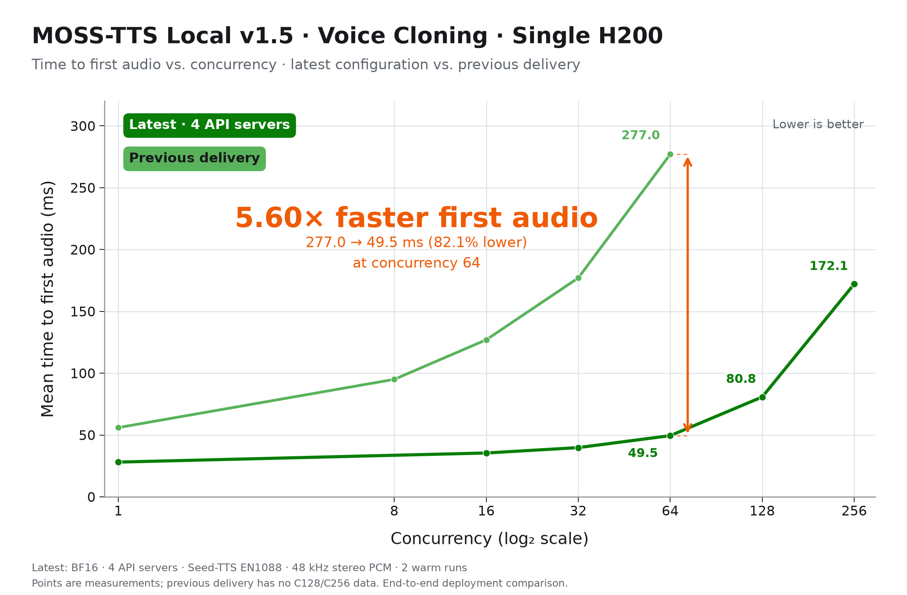

# MOSS-TTS Local v1.5：单卡 H200 的吞吐与首帧延迟

在单张 H200 上，最新部署配置在 **C64 达到 487.5 audio-s/s，平均 TTFP 为 49.5 ms**。相较上一交付版本，同并发下吞吐达到 **5.24 倍**，首帧等待时间缩短至约 **1/5.60**，下降 **82.1%**。

扩展到 C128，吞吐达到 **648.9 audio-s/s**，平均 TTFP 为 **80.8 ms**；C256 达到 **768.9 audio-s/s**，平均 TTFP 为 **172.1 ms**。模型使用 BF16，未量化。

## 与上一交付版本的对比



图 1：相同并发下的音频吞吐。C64 从 93.0 提升到 487.5 audio-s/s，为上一交付版本的 5.24 倍。



图 2：客户端测得的平均首帧延迟。C64 从 277.0 降至 49.5 ms，下降 82.1%。横轴采用 log₂ 刻度，圆点表示实测结果；旧版本仅测到 C64，因此没有 C128、C256 对比点。

两条曲线比较的是完整交付配置。旧版本数据来自上一交付模型卡，其精确代码版本、API 进程数量和预热细节未完整记录，因此倍数表示交付性能的变化，不代表某一项代码优化的独立收益。

## 最新性能

| 并发 | 音频吞吐（audio-s/s） | 平均 TTFP（ms） | 请求吞吐（req/s） | 平均端到端耗时（ms） | 平均 RTF |
|---:|---:|---:|---:|---:|---:|
| 1 | 15.6 | 28.1 | 3.17 | 314.6 | 0.065 |
| 16 | 179.7 | 35.4 | 36.26 | 436.0 | 0.089 |
| 32 | 310.8 | 39.8 | 63.04 | 496.6 | 0.102 |
| 64 | 487.5 | 49.5 | 99.17 | 620.6 | 0.129 |
| 128 | 648.9 | 80.8 | 130.83 | 912.1 | 0.188 |
| 256 | 768.9 | 172.1 | 155.85 | 1469.5 | 0.306 |

音频吞吐 = 生成音频的总秒数 ÷ 测量耗时；TTFP 是客户端收到第一段音频的耗时；RTF 是每条请求的端到端耗时 ÷ 生成音频时长，越低越好。表格采用已有两轮实测的汇总值：吞吐按总音频时长和总测量耗时计算，延迟按成功请求数加权。

## 部署

在已激活 `.venv`、安装了当前 MOSS 优化实现的环境中执行。vLLM 使用 0.31.0；模型自动使用默认的 `moss_tts_local.yaml`，两阶段运行在同一张 H200 上，默认启用 MPS。

```bash
vllm serve OpenMOSS-Team/MOSS-TTS-Local-Transformer-v1.5 \
  --omni --trust-remote-code \
  --host 0.0.0.0 --port 8124 --api-server-count 4 \
  --allowed-local-media-path /root/vllm-omni-workspace
```

默认 CUDA 配置的两阶段请求容量为 128。只有测 C256 时，才需要将 `platforms.cuda.stages` 中两个阶段的 `max_num_seqs` 改为 256，并将 Stage1 的 `cudagraph_capture_sizes` 扩展到 256；直接调整默认配置即可，无需额外 YAML。

## Benchmark

在 vLLM-Omni 仓库根目录运行，每个并发重复两轮：

```bash
VLLM_OMNI_BENCH_AUDIO_SAMPLE_RATE=48000 \
VLLM_OMNI_BENCH_AUDIO_CHANNELS=2 \
python benchmarks/tts/bench_tts.py \
  --host 127.0.0.1 --port 8124 \
  --model OpenMOSS-Team/MOSS-TTS-Local-Transformer-v1.5 \
  --task voice_clone --locale en \
  --dataset-path /root/vllm-omni-workspace/seedtts_testset \
  --num-prompts 1088 --concurrency 1 16 32 64 128 1 16 32 64 128 \
  --output-len 256 --output-dir ./results/moss-local-h200
```

测 C256 时，先按上文调整默认配置并重启服务，再将 `--concurrency` 改为 `256 256`。

测试使用完整 Seed-TTS 英文 1,088 条语音克隆请求，流式输出 48 kHz 双声道 PCM，参考音频以 inline base64 WAV 传入。正式测量前，666 个不同参考音频在每个 API 进程中分别预热，并执行一轮 C64 整体预热；预热不计入结果。上面的命令只展示正式压测，预热需在测量前完成，因此冷缓存直接运行不一定复现表中 TTFP。

表中数据沿用此前统一扩容到 256 后的完整并发扫描，并非本次简化命令的新测量。实测冷启动另将底层 engine 握手超时延长至 60 分钟，以容纳多桶图捕获；这只影响启动等待，不改变稳态推理。

本文复用 2026-10-12 已有测量，没有重新运行 benchmark。正式测量共 13,056 条请求，13,055 条成功；C16 的第二轮有 1 条 HTTP 500 且未输出音频，未重试，原因尚未确认。吞吐保留该轮完整测量耗时，延迟统计成功请求。本轮没有重新评测 WER/SIM。

图表借鉴 [vLLM DeepSeek-V4.1-Flash 博客](https://vllm.ai/blog/2026-10-07-deepseek-v41-flash)的深浅绿色曲线、橙色收益标注和简洁网格，图内文字使用英文。

图表另提供[合并版](figures/performance-comparison.png)、[吞吐 SVG](figures/audio-throughput.svg)和[首帧延迟 SVG](figures/first-audio-latency.svg)，可用于排版；最新原始精度数据见 [CSV](latest-performance.csv)。
